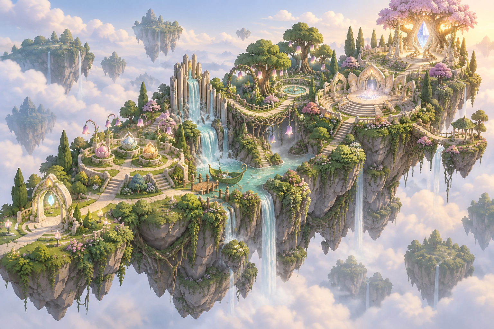

# World 2: Heart Melody — Production Implementation Plan

Status: implementation reference  
Prototype direction: `docs/concepts/heart_melody_world_two_prototype_v1.png`  
Canonical source: `World_Two_Heart_Melody_Concise_Developer_Guide_Implementation_Blueprints.docx`

## 1. Design decision

Heart Melody will reuse the proven **systems** of Mind Spark, not its industrial
appearance. It is one connected living valley with six gameplay zones and three
production regions. The world begins quiet and visually restrained, then gains
colour, water, movement, harmony and warm light as the player restores its song.

The visual ratio is:

- **55% nature:** landform, trees, flowers, roots, water, moss and vines.
- **30% gentle magic:** visible notes, harmonic light, responsive blooms and the
  Harmony Jewel.
- **15% discreet craft:** tuned stone valves, protected pivots, botanical
  mechanisms and the optional railway. Technology is embedded in nature.

The approved shape language is round terraces, petals, waves, roots, arches and
living instruments. Black machinery, clock faces, exposed gear walls, circuit
grids, floating route rings and solid guidance lines do not belong here.



This image is a direction prototype, not a Blender acceptance render. It defines
the route hierarchy, natural density, colour progression and landmark sequence.

## 2. Current implementation audit

| Area | Current status | Production implication |
|---|---|---|
| Quiet Meadow and Feeling Garden | **Implemented alpha** | Preserve the stable IDs and working quest logic; rebuild the sparse presentation around it. |
| Quest 1 save/reward safety | **Implemented** | State, migration and exactly-once reward tests pass. Do not rename existing IDs. |
| Castle gate integration | **Implemented** | Lazy build, prerequisite lock and transformed landing pass focused tests. |
| Player traversal | **Implemented on main route** | Main route and control aprons pass; the full visible oval still needs honest collision coverage. |
| Blender/GLB Island 1 kit | **Partially integrated** | Twenty-nine editable pairs exist, but runtime uses only a small subset. |
| Nature density and landmarks | **Prototype quality** | Current overview reads as two empty green ovals. Recompose it before extending the world. |
| Audio progression | **Prototype quality** | Three synthesized notes exist; layered ambience and restoration music are still required. |
| Quest 2–4 and zones 3–6 | **Proposed** | Build after the controller split and Island 1 presentation pass. |
| Full-world Web performance | **Release verification required** | Current tests establish structure, not final frame-time or download-size compliance. |

Focused verification on 2026-09-15 passed state, migration, gate, world,
traversal and architecture tests. The current alpha reports 26,998 static
triangles, 499 total mesh surfaces and 84 peak nearby surfaces.

## 3. What transfers from World 1

| Mind Spark production lesson | Heart Melody reconstruction |
|---|---|
| Stable chapter and task IDs | Add a World 2 chapter catalog while preserving the existing Island 1 quest and task IDs. |
| Quest director owns progression | Extract Heart Melody quest and encounter directors from the current monolithic world script. |
| One interaction boundary | Keep `available_actions()` and `interact(action, value)` for every functional object. |
| Environment reacts to quest state | Replace machine power states with bloom, water, wind, light, harmony and wildlife states. |
| Landmarks identify districts | Give every Heart Melody zone one dominant natural-musical silhouette. |
| Gates visibly match collision | Use vine, petal or stone closures with believable hinge, growth or retraction volumes. |
| Reusable object families | Create twelve nature-first functional families with authored states and collisions. |
| Player-height acceptance | Approve every object first from the real player camera, then from overview. |
| Save restores the whole world | Derive all visual and collision states from completed task IDs; never replay rewards. |
| Optional identity evidence | Record first responses through the shared identity tracker; never gate rewards or progression. |

Do not transfer World 1's ivory machine decks, giant gears, steam tanks,
astronomical rings or cyan circuit language. Warm ivory is only a supporting
material for paths, shrines, rail posts and instrument frames.

## 4. World layout

### 4.1 One valley, three production regions, six gameplay zones

```text
Art Castle
   |
[01 Quiet Meadow]
   |
[02 Feeling Garden]
   |
[03 Waterfall Organ River] -- optional completed-world station spur
   |
[04 Bell Grove + Peace Garden]
   |
[05 Harmony Stage]
   |
[06 Harmony Jewel Sanctuary]
   |
Creator's Light World Gate
```

The six zones remain contiguous. Three production regions make construction,
culling and testing manageable without turning the world into separate discs:

1. **Region A — First Breath:** Quiet Meadow + Feeling Garden.
2. **Region B — River Voice:** Waterfall Organ River + Bell Grove.
3. **Region C — Shared Song:** Harmony Stage + Jewel Sanctuary.

### 4.2 Spatial contract for every zone

Each zone must have:

- one dominant silhouette readable from the previous zone;
- one 6–7 m main path and a 4 m optional route;
- a clear arrival threshold, interaction apron and exit sightline;
- 1.2 m minimum safety edge beside drops, with no decorative gap large enough
  for the player capsule;
- a camera cone that does not put trees, rails or particles between the player
  and the active control;
- a simplified continuous floor collider under every visible walkable surface;
- explicit exclusion volumes for doors, bridge growth, vines, enemy attacks,
  foliage and NPC standing positions;
- silent, active, revision, completed and restored visual states;
- a checkpoint or safe return route before any combat or moving crossing.

## 5. Story and quest dependency

### World premise

The valley has not lost its feelings; it has lost the ability to let them become
music. The Blight has wrapped natural instruments in silence. The player does
not defeat feelings. They listen, name patterns, restore relationships and free
the living world from the shell that suppresses its voice.

### Quest 1 — Wake the Feeling Garden

**Current canonical ID:** `heart_melody.quest.wake_feeling_garden`  
**Target duration:** 12–14 minutes  
**Reward:** 80 quest XP

Playable sequence:

1. Enter through the Heart World Gate and meet Milo at a protected standing
   point that does not block the path.
2. Observe three dormant planter nests before making a choice.
3. Preview a feeling seed through colour, flower silhouette, icon and note.
4. Plant three seeds; any feeling is valid and no feeling changes the reward.
5. Listen to the garden's three-beat phrase.
6. Reproduce the phrase with Leaf, Sun and Droplet drum flowers.
7. On a mismatch, keep the attempted phrase visible, explain the differing beat
   and offer undo, replay, reset and progressive hint.
8. Release two Echo Moths and one Pulse Slime from the Blight shell through the
   existing encounter sequence.

Environmental result: planter terraces bloom, the first harmony stem enters,
quiet lamps wake and the root crossing grows toward the river.

### Quest 2 — Restore the River Song

**Proposed canonical ID:** `heart_melody.quest.restore_river_song`  
**Target duration:** 12–14 minutes  
**Reward:** 105 quest XP

Playable sequence:

1. Follow the newly grown crossing and hear the waterfall's missing intervals.
2. Tune three Water Organ valves. Each valve changes both pitch and visible
   water height, so the solution can be reasoned through sight and sound.
3. Free Hush Vines by matching tension, flow and note rather than attacking the
   plant itself.
4. Ring the Rain Boat Call Bell only after the three water voices agree.
5. Ride or walk beside the boat through a short safe river passage. The boat
   waits indefinitely and never strands the player.

Environmental result: water clears, reeds pulse in rhythm, mist catches coloured
light and the Bell Grove entrance opens.

### Quest 3 — Build the Heart Song

**Proposed canonical ID:** `heart_melody.quest.build_heart_song`  
**Target duration:** 12–15 minutes  
**Reward:** 130 quest XP

Playable sequence:

1. Restore three Harmony Bridge Chimes in different parts of Bell Grove.
2. Read the Fear Warning Bells as spatial telegraphs rather than danger labels.
3. Compare bell direction, interval and wind response to identify the safe
   crossing order.
4. Activate a Peace Flower checkpoint before the encounter lawn.
5. Release Rhythm Golems and the Dissonance Shell during clearly telegraphed,
   low-pressure combat.
6. Assemble the recovered chime voices at the Harmony Stage.

Environmental result: the vine bridge opens, warning bells become consonant,
flowers spread along the player-created rhythm and the Harmony Stage unfurls.

### Quest 4 — Free the Silent Conductor

**Proposed canonical ID:** `heart_melody.quest.free_silent_conductor`  
**Target duration:** 17–23 minutes  
**Reward:** 205 quest XP; boss 160 XP

Boss phases:

1. **Listen:** read broad musical wave telegraphs and move into quiet gaps.
2. **Join:** open three Beat Anchors during recovery windows; the anchors add
   the three songs already learned instead of behaving as generic switches.
3. **Free:** damage the exposed Blight core, then place the completed Heart Song
   at the centre. The Conductor is freed, not defeated.

Environmental result: the stage becomes a living amphitheatre, the path rises to
the Guardian sanctuary, the Harmony Jewel forms, the Harmony Shield is awarded
and the Creator's Light gate opens. The optional train spur becomes available
only after world completion.

## 6. Reusable functional object kit

Every family uses a shared base with named `StaticShell`, `Controls`,
`MovingParts`, `Feedback`, `Collision`, `InteractionArea` and `Audio` roots.
Required states are dormant, available, active, incorrect, revised, completed
and restored.

| # | Object family | Gameplay verb | Reusable Blender pieces | Environmental feedback |
|---|---|---|---|---|
| 1 | Feeling Seed Planter | preview / plant | root bowl, petal cradle, seed socket, three leaf shutters, note crystal | flower species, colour and note stem appear |
| 2 | Echo Drum Flower | listen / repeat | rooted stem, resonant petal membrane, symbol centre, response leaves | petals compress, pollen pulse shows timing |
| 3 | Water Organ Valve | tune / compare | carved stone pipe, leaf wheel, water window, reed pointer, protected pivot | pitch, water level and mist colour change together |
| 4 | Rain Boat Call Bell | call / board | bell flower, pull vine, leaf canopy, root dock cleat | river sends a visible answer ripple; boat approaches |
| 5 | Harmony Bridge Chime | restore / order | arch branch, hanging chime petals, striker seed, tension vines | bridge roots extend toward the next anchor |
| 6 | Hush Vine Release Knot | loosen / balance | braided vine bundle, three tension leaves, sap windows, root clasp | dark shell peels away; healthy vine remains |
| 7 | Comfort Lantern | rest / assist | ivory root pedestal, pearl pod, leaf cage, low halo | health/help state without altering puzzle answers |
| 8 | Song Memory Bench | replay / reflect | curved root seat, note-inlay back, memory petals, guardian perch | replays earned motifs and optional hints |
| 9 | Fear Warning Bell | observe / navigate | tall reed mast, directional bell, wind ribbon, ground echo petals | telegraph direction and safe interval become legible |
| 10 | Peace Flower Checkpoint | save / recover | broad flower seat, root circle, dew bowl, save pollen | calm light confirms checkpoint and restoration state |
| 11 | Silent Conductor Beat Anchor | open / join | petal armour, three rhythm shutters, root lock, heart-light core | adds one world motif and exposes a boss window |
| 12 | Harmony Jewel Altar | assemble / receive | guardian-tree roots, pearl cradle, four song facets, shield bloom | jewel, shield and next-world gate form visibly |

### Object art acceptance

- Silhouette must identify the verb from 25 m without a waypoint ring.
- The active control sits 0.9–1.4 m above the local floor unless it is a ground
  object, and faces the actual player approach.
- Moving parts have a documented pivot, sweep, rest position and collision rule.
- No moving solid intersects the player, another solid, foliage or its own frame.
- Small detail comes from bevels, weighted normals, restrained texture work and
  controlled triangulation—not arbitrary part counts.
- Emission highlights the current affordance only; it never floods the object.
- Incorrect and corrected states remain readable through shape as well as colour.

## 7. Environment architecture

### Zone 01 — Quiet Meadow

- Low, sheltered arrival court framed by willow-like trees and ivory root arches.
- World Gate is the dominant object and points directly toward the first planter.
- Muted sage, pearl and warm stone establish the silent starting state.
- Milo, Guardian and player each receive separate non-overlapping standing pads.
- Optional identity moment HM_ID_01 occurs during the greeting, never in a menu
  detached from the landscape.

### Zone 02 — Feeling Garden

- Three petal terraces create a triangular investigation loop around a lower
  drum lawn.
- Planters are large foreground landmarks; drum flowers are lower and circular.
- Combat clearings sit beyond the learning lawn, separated by hedge walls and
  safe recovery flowers.
- The restored root crossing is visible from the drums before it becomes usable.

### Zone 03 — Waterfall Organ River

- Tall organ cliff is the vertical landmark, built from pale stone fins, reeds,
  channels and water—not metal pipes.
- Three tuning bays occupy dry side terraces with protected valve sweeps.
- Boat dock and walking alternative share the same destination and checkpoint.
- Understructure uses rock ribs, deep roots, hanging moss and visible water exits.

### Zone 04 — Bell Grove and Peace Garden

- Overhead bell flowers make a shaded acoustic grove; low Peace Flowers mark safe
  space without looking like UI.
- Three chimes form a readable triangle around the vine bridge approach.
- Warning bells face the direction of incoming waves.
- Vegetation exclusion volumes keep telegraphs, combat and camera sightlines clear.

### Zone 05 — Harmony Stage

- Circular petal amphitheatre is the social and combat climax.
- Concentric seating terraces remain traversable; no decorative ring is solid
  unless its collision is visible and expected.
- Beat Anchors sit 120 degrees apart, each tied to one earlier musical motif.
- Stage transformation opens outward like petals, leaving a clear central arena.

### Zone 06 — Harmony Jewel Sanctuary

- Small, quiet, elevated sanctuary contrasts with the stage scale.
- Great Guardian Tree frames the altar and the next-world gate without blocking it.
- The Harmony Jewel forms at player eye level, then rises only after collection.
- Return route and Creator's Light gate remain physically readable after completion.

## 8. Materials, lighting and audio

### Shared material library

| Family | Use | Rule |
|---|---|---|
| Warm ivory limestone | gates, path borders, instrument frames | supporting structure, never the dominant ground carpet |
| Pale gold | hinges, note inlays, shrine accents | thin accents under 10% of visible surface |
| Sage / emerald foliage | primary nature mass | at least three value groups per local composition |
| Rose / lilac flowers | emotion and quest feedback | grouped by story state, not evenly scattered noise |
| Aqua water / note light | route continuity and musical response | animated locally; no solid neon lines |
| Pearl glass | seed, note and jewel lenses | small focal elements with restrained transparency |

Lighting progresses through three authored profiles:

1. **Silent Valley:** warm overcast morning, low saturation, sparse note motes.
2. **Voice Returning:** directional sun breaks, brighter water and local bloom.
3. **Full Harmony:** warm sunrise, layered canopy light, active sanctuary glow.

Audio uses cancellable, Web-safe layers: valley wind, water, leaves, distant bells,
one stem per restored quest, interaction one-shots, telegraph cues and a final
harmony layer. Mute must stop current and scheduled sounds immediately. Every
important audio cue also has visual and subtitle-equivalent feedback.

## 9. Runtime architecture

```text
Heart Melody chapter catalog
          |
          v
Heart Melody quest director ---> Active quest/task/checkpoint
          |                                  |
          v                                  v
Functional object base <---------- Player interaction adapter
          |
          v
Validation result ---> Environment state controller ---> Save/restore
          |                       |
          v                       v
HUD + captions              light / water / flora / audio / gates
```

### Required code boundaries

- `HeartMelodyChapterCatalog`: four quests, ten required tasks, six zones and
  stable aliases for the existing Island 1 save.
- `HeartMelodyQuestDirector`: task prerequisites, feedback, revision, completion,
  chapter completion and requested environment state.
- `HeartQuestObjectBase`: `configure`, `available_actions`, `interact`,
  `completed`, `feedback` and `hint_requested`.
- `HeartMelodyEnvironmentState`: derives all visual, collision, gate and audio
  states from saved IDs.
- `HeartMelodyEncounterDirector`: enemy cap, pause, retry, checkpoint and boss
  phase transitions.
- `HeartMelodyAudioDirector`: cancellable scheduled notes, stems, captions and
  reduced-sensory behavior.
- `HeartMelodyHUD`: objective, replay, undo, reset, hints, input prompts and local
  map across keyboard, pointer, controller and touch.

`HeartGardenWorld` should eventually retain only activation, checkpoint restore,
world transform and Castle integration. Its current quest, UI, audio and encounter
responsibilities must be extracted before Quest 2 is added.

## 10. Save, progression and identity

- Preserve `heart_melody.quest.wake_feeling_garden`,
  `heart_melody.task.plant_feeling_seeds` and
  `heart_melody.task.restore_garden_rhythm`.
- Add new quest/task IDs only; never repurpose an old receipt.
- Save after every completed task, checkpoint, first identity answer and world
  state transition.
- Restore from task IDs without replaying XP, bridge animations, music stingers
  or item grants.
- Legacy Harmony Jewel entitlement remains valid for revisit compatibility.
- Reflections are private, skippable, non-diagnostic and non-gating.

Identity evidence is staged in the world:

| Moment | Quest location | Axis | Prompt context |
|---|---|---|---|
| HM_ID_01 | Quiet Meadow greeting | E / I | approach the new world with others or quietly first |
| HM_ID_02 | Seed preview | S / N | notice one concrete sound or imagine the whole garden |
| HM_ID_03 | Rhythm help | T / F | compare the pattern or support the feeling it carries |
| HM_ID_04 | Garden completion | J / P | finish the sequence or continue exploring variations |
| HM_ID_05 | River route | E / I | ask for help or investigate alone first |
| HM_ID_06 | Water Organ | S / N | tune one water detail or the whole musical shape |
| HM_ID_07 | Beat Anchor | T / F | choose an anchor through evidence or relational meaning |
| HM_ID_08 | Sanctuary reflection | J / P | preserve an ordered song or leave room for improvisation |

Only the first non-private response becomes evidence. Results remain hidden until
the Art Castle finale and never change difficulty, rewards or story access.

## 11. Blender-to-Godot production workflow

1. Greybox the three production regions and six route zones in Godot first.
2. Validate full-footprint floor collision, player capsule, camera and sightlines.
3. Build Blender source by modular family: terrain, roots, paths, barriers,
   instruments, quest objects, foliage, gates and sanctuary.
4. Name static, moving, feedback and collision parts before export.
5. Apply transforms, bevel primary edges, author weighted normals and triangulate
   deliberately at export.
6. Export one GLB per reusable module or landmark; do not export the whole valley
   as one unstreamable mesh.
7. Replace greybox modules without changing quest IDs or interaction transforms.
8. Add LOD/visibility ranges and MultiMesh vegetation cells by production region.
9. Validate material slots, pivot motion, collision and restored state in Godot.
10. Capture player-height and overview images before a module is approved for reuse.

Suggested asset roots:

```text
assets3D/heart_melody/shared/
assets3D/heart_melody/region_a_first_breath/
assets3D/heart_melody/region_b_river_voice/
assets3D/heart_melody/region_c_shared_song/
scenes/heart_melody/objects/
scenes/heart_melody/environment/
scripts/heart_melody/
data/heart_melody_chapter.json
```

## 12. Delivery sequence

### Phase 0 — Compatibility lock

- [ ] Snapshot current Island 1 IDs, receipts, saves, checkpoints and Castle gate.
- [ ] Add migration fixtures for fresh, partial, completed and legacy Jewel saves.
- [ ] Record current player route, triangle, surface and construction-time baselines.

### Phase 1 — Controller split

- [ ] Extract quest, encounter, audio and HUD responsibilities from
  `HeartGardenWorld`.
- [ ] Complete the shared Heart quest-object interface.
- [ ] Add additive chapter catalog fields for zone, mechanic, binding, prerequisite,
  hint, success effect and environment state.

### Phase 2 — Finish Region A

- [ ] Replace sparse ovals with layered meadow, terraces, drum lawn and clearings.
- [ ] Cover every visible walkable surface with simplified collision.
- [ ] Integrate the delivered Blender kit instead of existence-checking it only.
- [ ] Add seed preview, exact drum hint, calm creature forms, authored audio and the
  complete restoration transition.

### Phase 3 — Build Region B and Quest 2

- [ ] Greybox the organ cliff, tuning terraces, dock, river route and Bell Grove.
- [ ] Implement three multimodal Water Organ valves and Hush Vine release logic.
- [ ] Implement the always-recoverable Rain Boat and walking alternative.
- [ ] Add Quest 2 catalog, save, audio, identity and environment states.

### Phase 4 — Build Quest 3

- [ ] Build Bell Grove chime triangle, warning corridors and Peace Garden.
- [ ] Implement chime-order reasoning and visually matched telegraphs.
- [ ] Add Rhythm Golem and Dissonance Shell encounters with ≤4 normal enemies.
- [ ] Open and persist the Harmony Stage route.

### Phase 5 — Build Region C and Quest 4

- [ ] Build stage, Beat Anchors, boss-safe arena and Jewel Sanctuary.
- [ ] Implement Listen, Join and Free phases with ≥0.75 second telegraphs.
- [ ] Implement completed-song placement, Conductor release, Jewel, Shield and gate.
- [ ] Unlock the optional station only after completion.

### Phase 6 — Final art and sensory pass

- [ ] Complete the shared material library, foliage cells and three lighting states.
- [ ] Add five progressive music stems, spatial ambience and accessible equivalents.
- [ ] Replace remaining procedural prototypes with accepted Blender modules.
- [ ] Complete LOD, culling, occlusion and frame-spread construction.

### Phase 7 — Production acceptance

- [ ] Complete the entire world with real player movement and player camera.
- [ ] Verify keyboard, pointer, controller and supported touch controls.
- [ ] Verify desktop, tablet and phone UI.
- [ ] Test every correct, incorrect, undo, replay, reset, hint, partial reload and
  completed reload path.
- [ ] Verify all doors, bridges, valves, plants, enemies and players respect mass.
- [ ] Verify no deadlock, early gate, duplicate XP, repeated item or stale collision.
- [ ] Profile native and Web visible triangles, draw calls, frame time, memory and
  download size from each zone.
- [ ] Require ≥30 FPS at 1280×720 on the agreed low reference device; target 60 FPS
  on the development machine.
- [ ] Capture six zone overviews, player-height object views and a full quest video.

## 13. Prototype acceptance before detailed modelling

The next greybox is approved only if:

- the six landmarks are visible in order from the isometric overview;
- the player can walk the complete route without entering decorative voids;
- the world reads as one valley, not disconnected discs;
- each quest object faces the route and has an unobstructed interaction apron;
- nature occupies most of the composition without hiding gameplay;
- the silent-to-harmony transformation is obvious with no UI explanation;
- the optional station reads as secondary and remains inaccessible before completion;
- the existing Island 1 tests still pass unchanged.

## 14. Immediate next build

Do not begin Quest 2 art first. The safest next milestone is:

1. refactor the current Island 1 controller;
2. repair full-footprint collision;
3. rebuild Quiet Meadow and Feeling Garden to the prototype density;
4. complete seed, rhythm, audio and restoration feedback;
5. freeze Region A transforms;
6. then greybox Waterfall Organ River against the frozen crossing endpoint.

This prevents a prototype-quality Island 1 from becoming the permanent scale,
composition and code foundation for the rest of Heart Melody.
