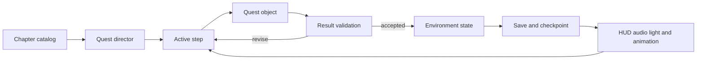
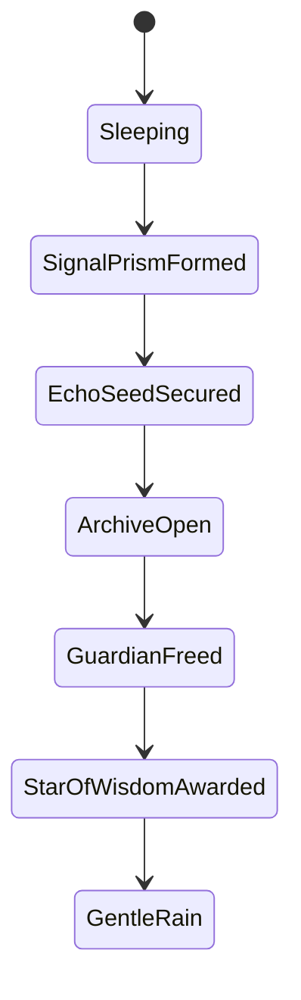

# Mind Spark World One Implementation Handbook

**Document purpose:** This is the authoritative design and engineering reference for World 1 of ARTÉA. It connects the three-island environment, five canonical quests, twenty narrative tasks, ten walkable-world milestones, reusable quest objects, optional identity evidence, player interaction, saved progression, art production, and release verification.

**Audience:** Game design, narrative, environment art, Blender production, Godot engineering, UI, audio, quality assurance, and future agents working on Mind Spark.

**Status vocabulary**

- **Implemented:** Present in the current source and covered by at least one focused automated test.
- **Proposed:** Approved implementation direction that is not yet completely represented in production code or art.
- **Release verification required:** Present at source level but still needs a complete player-camera and Web performance pass.

## 1 Product decision

World 1 is one connected emotional and mechanical journey across **three physical islands**. Six internal gameplay districts remain for compatibility, but they must never be presented as six separate islands. The player completes **five canonical quests** and discovers the **Star of Wisdom**.

The emotional learning sentence is:

> I can notice a difficult thought, understand what supports it, and choose one grounded, hopeful next step.

The player does not destroy unwanted thoughts. They observe signals, separate evidence from prediction, test relationships, revise an explanation, choose a grounded response, and transform the surrounding world through that reasoning.

### Non-negotiable content policy

**Implemented** in `mind_spark_chapter.json` and enforced by the catalog validator:

- Curated offline content only.
- No free-text analysis of a player's emotions.
- No diagnosis, generative AI, network dependency, or scoring of inner state.
- Faith and universal guardian profiles remain available.
- Reflection choices are private, skippable, non-gating, and reward-neutral.
- No reasoning timer and no loss of progress for an incorrect attempt.

## 2 System structure



### 2.1 Sources of truth

| Responsibility | Authority | Contract |
| --- | --- | --- |
| Narrative identity and safety | `data/mind_spark_chapter.json` | Five canonical quest IDs, twenty tasks, profiles, consequences, reflections, and runtime bindings |
| Cooperative encounter order | `data/mind_spark_encounters.json` | Alarm Lens, Hope Lens, role exchange, authored action order, and evidence receipts |
| Walkable-world progression | `mind_spark_world_one_quest.gd` | Ten saved milestones, XP, gates, Island 1 to 2 handoff, Island 3 completion, and legacy save aliases |
| Reusable interactions | `quest_object_base.gd` | `interact(action, value)`, available actions, persistence, visible state, feedback, and completion |
| Private identity evidence | `player_identity_tracker.gd` | First-answer preservation, four axes, quest and task provenance, private preview, accepted finale result, and replay state |
| Environment construction | `mind_spark_world_one.gd` plus island campus modules | Three foundations, six districts, routes, barriers, gates, machines, vegetation, cast, and encounters |
| Save restoration | checkpoint and object state stores | Stable IDs, idempotent rewards, partial progress, completed visual restoration |

### 2.2 Canonical and runtime naming

**Implemented.** Canonical IDs are permanent. Existing runtime IDs remain save aliases.

| Order | Canonical ID | Player-facing subtitle | Existing save alias |
| ---: | --- | --- | --- |
| 1 | `quest.signal_observatory` | Notice the Signal | `notice_signal` |
| 2 | `quest.echo_forest` | Listen to the Echo | `island_one_awareness` |
| 3 | `quest.cross_seam_relay` | Understand the Moment | `broken_pattern` |
| 4 | `quest.role_exchange_storm` | Build a Possible Tomorrow | `hope_path` |
| 5 | `quest.constellation_synthesis` | Calm the Thought Storm | `free_warden` |

The catalog exposes `quest_for_runtime_id()` and `runtime_contract()` so presentation and future systems can resolve either name without rewriting a save file.

### 2.3 Runtime event contract

**Implemented.** Directors expose events for step start, accepted or rejected feedback, revision, step completion, canonical quest completion, requested environment state, and chapter completion. A listener may animate the world or update UI, but it must never award progression independently.

Each completion receipt is idempotent. Restoring a completed save rebuilds gates, weather, equipment, and station states without replaying XP, treasure, dialogue rewards, or completion audio.

## 3 World map and player journey

```text
ARTÉA CASTLE
     |
     v
ISLAND 1  Heavenly Research Campus
  District 01  World Gate and Signal Observatory
        Quest 1  Notice the Signal
  District 02  Echo Garden and Living Network Forest
        Quest 2  Listen to the Echo
     |
     | Echo Seed and golden threshold
     v
ISLAND 2  Observatory of Understanding
  District 03  Evidence Constellation Court
        Quest 3  Understand the Moment
  District 04  Hope Path Ridge
        Quest 4  Build a Possible Tomorrow
     |
     | Shared Horizon and departure gate
     v
ISLAND 3  Storm to Sanctuary
  District 05  Thought Storm Arena
  District 06  Oldest Tree Sanctuary
        Quest 5  Calm the Thought Storm
     |
     v
STAR OF WISDOM AND CASTLE RETURN
```

### Route rules

- The primary route must be readable from player height without solid colored guide lines or floating waypoint rings.
- Bridges land on continuous collision surfaces and terminate at a clearly related gate or forecourt.
- The Memory Gate sits before the Island 2 progression crossing, faces the incoming approach, and opens on protected hinges.
- Every required route has an accessible alternative to optional jumping or timing challenges.
- Railings cover exposed ground-level edges except at deliberate bridge, stair, ramp, or maintenance openings.
- Empty operating aprons remain intentional. Decorative filling never blocks a control, clue, camera view, or door sweep.

## 4 Story and quest implementation

### Quest 1 The Signal Observatory

**Island:** One. **District:** World Gate Landing. **Runtime milestone:** Form the Signal Prism. **Status:** Implemented; player-camera and Web release verification required.

**Story:** A floating thought arrives as a visitor, not an enemy. The Everlasting Father or Guardian of Wisdom teaches the player to notice its words and effects before choosing what to do.

**Playable sequence:**

1. Enter through the paired threshold and establish the Alarm and Hope lenses.
2. Route Thought, Feeling, and Choice through three different light instruments.
3. Use the analysis console to identify how the thought changes attention, body signal, and possible action.
4. Balance west and east pressure regulators; changing one affects the other.
5. Align coupled outer, middle, and inner rings to Notice, Understand, and Choose.
6. Confirm the stable composition and form the Signal Prism.

**Revision behavior:** A repeated instrument, unbalanced regulator, or misaligned ring preserves prior work and identifies the specific mismatch. Progressive hints move from locating an unlit channel to explaining the coupled relationship.

**World response:** Observatory conduits synchronize, local lights warm, the Wisdom Tree begins to glow, and the internal garden gate opens. The environment response must use localized light and moving machinery rather than a generic success ring.

### Quest 2 The Echo Forest

**Island:** One. **District:** Living Network Forest. **Runtime milestone:** Carry the Echo Seed forward. **Status:** Implemented; final environment polish and Web verification required.

**Story:** The Signal Prism reveals echoes inside the thought. The player learns that an echo may describe a fact, a possibility, or an uncertainty.

**Playable sequence:**

1. Install the Signal Prism in the garden collector.
2. Visit three receivers and match their source phase using linked plus-two and plus-three gear changes.
3. Capture each stable echo rather than chasing moving particles.
4. Classify the authored echoes as Fact, Possibility, or Unsure.
5. Assemble the protective question that helps without promising a perfect outcome.
6. Test four relationships at the Caution Beacon and revise any unsupported connection.
7. Form the Echo Seed, save at the Server Roots, and complete the existing Spark relay.

**World response:** Root conduits carry staged pulses, flowers and lanterns awaken in sequence, and the golden threshold to Island 2 becomes available.

### Quest 3 The Cross Seam Relay

**Island:** Two. **District:** Evidence Constellation Court. **Runtime milestones:** scan evidence, restore memory, open logic gate. **Status:** Implemented at source level; release verification required.

**Story:** Ari's living projection stopped. The intact Echo Seed separates into Event, Prediction, and Choice so the player can investigate without treating Ari's fear as proof of blame.

**Playable sequence:**

1. Focus the optical plate, recorder, and cooling valve with distinct adjustments.
2. Capture all three observations before selecting an explanation.
3. Reorder the event strips and replay the reconstructed sequence.
4. Test how beam drift, cooling loss, and protective shutdown relate.
5. Mark what the evidence explains and what remains unknown.
6. Verify the causal model at the archive logic gate.

**World response:** The Evidence Aether Bus visibly carries power from the scanner through the Memory Board to the gate. Each receptacle changes independently. The physical Memory Gate opens only after the required evidence chain is saved.

### Quest 4 The Role Exchange Storm

**Island:** Two. **District:** Hope Path Ridge. **Runtime milestones:** turn lens, restore projection, share with Ari. **Status:** Implemented at source level; role presentation, final art, and Web verification required.

**Story:** Evidence explains the interruption but does not choose the next step. The player and Ari exchange investigative roles so neither person is permanently labeled as the fearful or hopeful one.

**Playable sequence:**

1. Examine Ari's feeling, the machine's behavior, and the helper's offer through three lens positions.
2. Exchange roles in solo-companion or local cooperative play.
3. Reject the fear conclusion and the unsupported fantasy.
4. Select one grounded approach: small test, collaboration, or cooling-first.
5. Tune coupled mirror, shutter, and plate controls and preview the leaf projection.
6. Undo, revise, or commit the projection.
7. Share the changed result with Ari.

**World response:** The living leaf pattern grows through the Hope Materialisation Conduit, the pavilion changes from cool evidence light to warm sunrise light, and the Shared Horizon opens the route to Island 3. Island 2 reasoning never requires enemy defeat.

### Quest 5 The Wisdom Constellation

**Island:** Three. **Districts:** Thought Storm Arena and Oldest Tree Sanctuary. **Runtime milestones:** free Warden core and change storm to gentle rain. **Status:** Core combat and rain transformation implemented; expanded storm-reading and authored finale are proposed.

**Story:** The final island externalizes the thought storm. The player applies the same skills under movement pressure, repairs rather than conquers the Warden mechanism, and turns four discoveries into a constellation that belongs to them.

**Playable sequence:**

1. Read a preview of the next storm line before moving.
2. Dodge wide telegraphed lines and reach three Warden Anchors.
3. Strike only while an anchor's ring is open; closed-ring strikes provide corrective feedback.
4. Repair the exposed crystal core and stop the storm mechanism.
5. Hold at the Calm Rain Basin without a timed input.
6. Recall four earned lights: noticing, evidence, perspective, and choice.
7. Connect the four lights freely; connection is required, not one perfect drawing.
8. Choose to receive the Star, carry it beside the player, or watch it join the Crown. Every choice grants the same reward.

**World response:** Rain replaces hostile storm effects, the Oldest Tree awakens from root to crown, the Star of Wisdom forms, and the Castle return route opens.

## 5 Puzzle design contract

Every required puzzle uses this loop:

1. **Observe:** Read a signal, physical state, authored clue, or environmental change.
2. **Manipulate:** Rotate, route, order, balance, classify, tune, dodge, or connect.
3. **Interpret:** Explain what the state supports without diagnosing the player.
4. **Confirm:** Deliberately commit a model or artistic arrangement.
5. **Transform:** Change architecture, machinery, vegetation, weather, sound, and light.

### Failure-free requirements

- Incorrect input names the affected relationship and keeps unrelated progress.
- Reset clears only the current puzzle scope.
- Replay reproduces evidence without duplicating rewards.
- The first hint points to where to look, the second describes the relationship, and the final hint states a viable next action.
- Focus Bell help remains optional and cannot submit an answer.
- Reduced-motion mode replaces rotation, pulses, and camera motion with fades, pose changes, and text or shape cues.
- Color is never the only state indicator.

## 6 Reusable quest object kit

| Object family | Primary verb | Required silhouette and components | Gameplay state |
| --- | --- | --- | --- |
| Thought Spark Socket | Place | Grounded receiver bowl, protected core, three indexed channels | Available sparks, placed count, linked-task open |
| Evidence Scanner | Inspect | Sloped desk, specimen tray, lens yoke, shutter, adjustment controls | Unscanned, adjusted, captured, classified |
| Perspective Lens | Reframe | Stable gimbal, bearing blocks, three detents, faceted lens | View, interpretation, reset, complete |
| Memory Constellation Board | Order | Broad teal slate, three sockets, supported channels, reset grip | Sequence, replay, mismatch, restored |
| Logic Gate Arch | Verify | Load-bearing piers, evidence receptacles, crown mechanism, physical door | Locked, partially powered, tested, open |
| Truth Bridge Tile | Build | Supported inlaid frame, approach keys, coupled optics, output lens | Approach, tuning, preview, projected |
| Focus Bell Beacon | Ask for help | Compact foot, forked yoke, bell, clapper, visible help marker | Hint off, hint ready, hint active |
| Warden Anchor | Repair | Armored base, warning emitter, vulnerable ring, broken core | Telegraph, vulnerable, recovery, repaired |
| Calm Rain Basin | Transform | Wide supported basin, inlet machinery, water surface, weather lens | Dormant, holding, rain active |
| Identity Reflection Mirror | Reflect | Stable frame, private surface, choice controls | Private, answered, skipped, replayable |
| Checkpoint Server Root | Save | Rooted pedestal, archive core, heal and task controls | Save, heal, current task, restored |
| Clear Path Projector | Navigate | Grounded projector, shutter, route lens, direction plate | Route off, route on, target changed |

### Art and Blender contract

- One silhouette communicates one verb. Repetition is allowed only inside a clearly labeled set.
- Editable Blender source separates `StaticShell`, `Controls`, `MovingParts`, `FeedbackParts`, and `CollisionReference` collections.
- Runtime GLB names remain stable because state adapters locate named components.
- Model silhouette-changing details; bake minor seams, grain, and engraving into shared textures.
- Use bevels, deliberate triangulation, split or weighted normals, and consistent smoothing. Triangles alone do not make a surface smooth.
- Keep moving parts, gameplay anchors, and collision separate from static batching.
- Reuse mesh and material resources for railings, lanterns, planters, bearings, sockets, and fasteners.
- Do not treat three thousand independent objects as a quality target. Record editable parts, triangles, draw calls, materials, and texture memory separately.

## 7 Environment architecture

### Island 1 Heavenly Research Campus

**Implemented with polish remaining.** The arrival lobe contains the World Gate and optical laboratory. The garden lobe contains the hero Wisdom Tree, quiet listening terraces, Echo instruments, and living root circuitry. Ivory civic stone establishes calm order; brass expresses load paths and mechanical interfaces; teal glass identifies observation; emerald and sage vegetation carries the living response.

### Island 2 Observatory of Understanding

**Implemented at source level; release verification required.** The Evidence Court uses scholarly instrument forms and dark-teal recesses behind ivory stations. The Hope Ridge opens into a warmer sunrise pavilion and planted terraces. The Memory Gate sits before the departure route, opens on physically protected outward hinges, and keeps visual and collision states synchronized.

### Island 3 Storm to Sanctuary

**Proposed production pass.** The arena begins dense and mechanical: storm harvesters, large foundation engines, protected service galleries, anchor conduits, and readable energy direction. Toward the sanctuary, the architecture becomes quieter and more organic. The Oldest Tree is the dominant landmark, surrounded by four memory-light stations and a final constellation dais.

### Spatial station blueprint

Every station must record:

- Intended approach vector and front direction.
- Minimum clear operating apron of three player-capsule diameters.
- Standing camera cone and readable distance.
- Control reach, moving-part sweep, and door sweep.
- Solid collision envelope and non-colliding guidance envelope.
- Accessible route, optional challenge route, and fall protection.
- Planting exclusion zone and lighting influence zone.
- Dormant, available, active, revision, completed, and restored poses.

## 8 Player control and presentation

**Implemented foundation:** player movement, proximity interaction, quest panels, solo companion commands, local cooperative lenses, checkpoint actions, and optional private reflection.

**Required presentation behavior:**

- The nearest valid control receives focus; overlapping stations never compete.
- A prompt shows the verb, required input, and current progress.
- Multi-choice puzzles expose authored buttons or equivalent controller and touch focus targets.
- The HUD displays canonical quest order, player-facing subtitle, current task, purpose, and concise feedback.
- Camera remains player-controlled during reasoning. Completion shots may briefly frame the affected machinery but must return control safely.
- Touch layouts preserve readable type and reachable actions on phone and tablet aspect ratios.

## 9 Environment state and persistence



The five catalog environment states are:

1. `signal_prism_formed`
2. `echo_seed_secured`
3. `archive_open`
4. `guardian_freed`
5. `star_of_wisdom_awarded`

Existing Island 2 intermediate phases remain valid: dormant, invited, received, evidence sorted, memory woven, archive open, hope reframed, truth materialised, and guardian freed.

Save restoration derives the world from completed IDs. It must not infer completion from a decorative animation, enemy absence, position, or current camera view.

### 9.1 Identity evidence tracked by quest

**Implemented.** Mind Spark contributes eight optional evidence moments to the shared `PlayerIdentityTracker`. Evidence describes an explicit choice; it never infers personality from success, failure, movement speed, combat performance, hint use, or private text. Opening, answering, or skipping a reflection cannot alter a quest, gate, XP award, treasure, or checkpoint.

```text
TASK COMPLETED
      |
      v
OPTIONAL REFLECTION QUEUED --skip/private--> NO EVIDENCE WRITTEN
      |
      v
PLAYER OPENS WITH R
      |
      +-- 1 first authored choice
      +-- 2 second authored choice
      +-- 3 private or skip
      |
      v
FIRST EXPLICIT ANSWER SAVED WITH QUEST AND TASK PROVENANCE
```

| Canonical quest | Evidence ID and triggering task | Axis | Explicit choices |
| --- | --- | --- | --- |
| `quest.signal_observatory` | `MS_ID_01` after `wake_two_roots` | E / I Energy | Talk and act with others / Think and act quietly |
| `quest.echo_forest` | `MS_ID_02` after `collect_two_sparks` | S / N Focus | Notice clear details / Notice patterns and possibilities |
| `quest.cross_seam_relay` | `MS_ID_03` after `scan_fact_fear` | T / F Decision | Use reason and rules / Use care and personal values |
| `quest.cross_seam_relay` | `MS_ID_04` after `restore_memory` | J / P Approach | Plan the order / Explore and adapt |
| `quest.cross_seam_relay` | `MS_ID_05` after `open_logic_gate` | E / I Energy | Ask for help / Try quietly first |
| `quest.role_exchange_storm` | `MS_ID_06` after `turn_lens` | S / N Focus | Follow one pattern detail / Follow the big picture |
| `quest.constellation_synthesis` | `MS_ID_07` after `free_warden_core` | T / F Decision | Follow the safe rule / Protect the living storm |
| `quest.constellation_synthesis` | `MS_ID_08` after `place_final_spark` | J / P Approach | Reflect in order / Replay what stood out |

Every saved record contains `evidence_id`, `axis`, `choice`, normalized `side`, `world_id`, `canonical_quest_id`, legacy `save_alias`, `task_id`, and `source`. `evidence_for_quest()` and `identity_progress_by_quest()` provide read-only summaries for UI and testing without changing progression.

**First-answer and privacy contract:**

- The first explicit answer for an evidence ID is preserved. Replay cannot overwrite or increment it.
- Skip or private closes the moment without writing an axis.
- The evidence file saves immediately and restores independently of the world-progress file.
- A result cannot be previewed until every axis has at least one explicit answer.
- Mind Spark never calls `finalize_identity()` and never displays a friendly identity name.
- Once the player accepts the Art Castle result, new evidence is rejected and the result is locked.

**Art Castle finale implemented.** After the three kingdom treasures are saved, the gallery creates a private Identity Reflection panel. It previews the four-letter result and friendly name without locking it. The player may accept the reflection or keep it private. Acceptance calls `finalize_identity()`, updates the Identity Star label, saves `identity_locked`, and records that the reveal was seen. A persistent Identity Reflection button reopens the reveal without recounting evidence.

When paired counts tie, the current deterministic finale rule chooses the first side of the pair: E, S, T, or J. This rule exists only to produce one of the sixteen authored friendly names at the finale; it is not shown as a score or psychological diagnosis.

## 10 Visual audio and accessibility feedback

- **Observation:** cool teal focus, quiet optical clicks, local glass response.
- **Valid manipulation:** restrained brass movement, clear detent sound, visible shape change.
- **Revision:** warm neutral pulse, explanatory text, no alarm or damage sound.
- **Completion:** energy travels from source through the actual mechanism to its destination.
- **World completion:** storm density falls, rain begins, tree lighting grows upward, and the constellation settles into a readable form.

Spatial sounds must be attached to their real source. Completion audio plays once per receipt. Muting, volume controls, reduced motion, and textual equivalents remain functional after reload.

## 11 Test and release checklist

### Data and progression

- [x] Exactly three physical islands and six compatibility districts.
- [x] Exactly five canonical quests and twenty narrative tasks.
- [x] Exactly twelve reusable quest object families.
- [x] Legacy runtime quest IDs resolve to canonical IDs.
- [x] Curated offline content policy is validated.
- [x] Catalog, encounter-director, and complete walkable-story tests pass.
- [x] Eight stable Mind Spark identity evidence IDs retain canonical quest and task provenance.
- [x] First-answer preservation, skip/private behavior, identity preview, finale acceptance, and reload tests pass.
- [ ] Record a schema-v1 fixture and prove load compatibility after future schema changes.

### Puzzle behavior

- [ ] Verify correct path, incorrect path, hint ladder, undo, reset, replay, rapid input, partial reload, and completed reload for every puzzle.
- [ ] Verify no early gate, duplicate XP, repeated reward, stale collision, or deadlock.
- [ ] Verify all three valid Living Projector approaches.
- [ ] Verify closed and open Warden Anchor feedback.

### Environment and physics

- [ ] Walk the complete route with the production player capsule.
- [ ] Inspect every bridge seam, ramp, stair, barrier, station apron, and gate sweep.
- [ ] Confirm no solid moving object intersects another solid object.
- [ ] Confirm decorative guidance is non-colliding and essential architecture has mass.
- [ ] Capture overview and player-height images for all three islands.

### UI audio and Web

- [ ] Test keyboard, pointer, controller, and supported touch input.
- [ ] Test desktop, tablet, and phone aspect ratios.
- [ ] Verify background, lighting, materials, spatial sound, mute, and volume in Web.
- [ ] Verify keyboard, controller, pointer, and touch operation of the Art Castle Identity Reflection panel.
- [ ] Record player-perspective videos of the five-quest route.
- [ ] Measure frame-time distribution, visible triangles, draw calls, texture memory, and download size.
- [ ] Require at least 30 FPS at 1280 by 720 on the agreed lower reference device and aim for 60 FPS on the reference development machine.

## 12 Implementation order

1. Keep this handbook and its DOCX synchronized with source behavior.
2. Preserve canonical IDs and save aliases before changing presentation.
3. Finish Island 1 visual and Web acceptance before altering its puzzle rules.
4. Finish Island 2 player-camera, gate-sweep, collision, and Web acceptance.
5. Build Island 3's expanded storm-reading and authored constellation sequence behind the existing Quest 5 save IDs.
6. Complete audio, accessibility, touch, performance, and full-route evidence.
7. Record approved screenshots, videos, Blender sources, GLBs, metrics, and known limitations.

## 13 Definition of done

World 1 is complete only when the same five-quest journey can be started, played, saved, restored, completed, and returned to the Castle in native and Web builds; every puzzle supports revision without punishment; every gate and moving mechanism has correct collision; every quest visibly transforms its environment; all eight optional identity moments preserve privacy and canonical quest provenance; the Art Castle reveal remains player-accepted and replayable; and the final handbook accurately matches the tested game.

The original `AGENTS.md` is outside this implementation and must remain unchanged.
