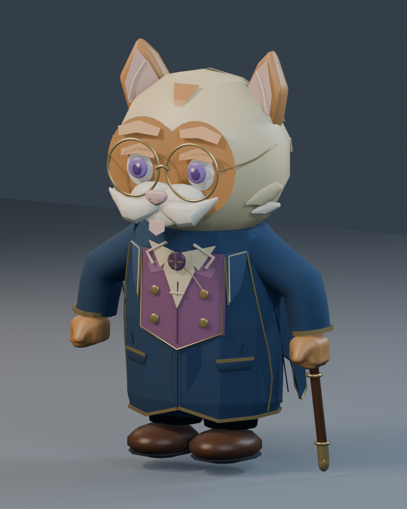

# Milo — local redesign and movement trace

Status: editable review version, **not installed in the live game, committed,
pushed, uploaded, or deployed**. Existing uncommitted Milo work was preserved.



## Deliverables

- `milo_redesign.blend`: editable character, shared armature, materials, named
  parts, studio camera, and animation actions.
- `milo_redesign.glb`: self-contained runtime candidate; 125 meshes, 41 joints,
  24,206 triangles, 12 animation clips, approximately 1.62 MB.
- `milo_viewer.html`: self-contained offline rotation / animation viewer. The
  first button cycles idle, welcome, listening, walk, and bind pose. The browser
  tool blocked local file navigation, so interactive viewer verification is
  **not complete**. Inline JavaScript syntax and embedded resources were checked.
- `front.png`, `side.png`, `back.png`, `hero.png`: Blender renders.
- `Milo_Redesign_Welcome_0.png` through `_4.png`, and `Milo_Walking_0.png` through
  `_4.png`: sampled movement poses, not a continuous motion-capture sequence.
- `tailoring.json` / `tailoring.glb`: reproducible AnyCreature clothing geometry.
- `build_redesign.py`: Blender assembly and animation source.
- `blender_validation.json`, `regressions.json`, and regression logs: measured QA.

## What changed

Milo remains the cream-and-caramel elder cat with purple eyes, a white moustache,
gold spectacles, a cane, and a tail-free coat silhouette. This version introduces
rounded continuous sleeves, thinner round spectacle rims, softer cheek/moustache
edges, midnight-blue tailoring, a muted plum waistcoat, an ivory cravat, smaller
buttons, polished brown shoes, and a four-point compass brooch.

AnyCreature generated the torso-and-arm tailoring study, including a skeleton,
skinning, and idle/move/greet test clips. Its sleeve surfaces are used in the final
model; the torso study is **not** substituted for the existing coat. Blender
transfers the original sleeve weight fields onto those surfaces and retains the
existing character's face, clothing pieces, paws, and skeleton. This is a
redesign of the existing character, not a claim that AnyCreature generated every
part or that the existing rig was built from scratch.

Blender 5.2.0 LTS ran locally through its Python API. No connected Blender plugin
tool was available; no plugin was silently installed. AnyCreature's installed
local dispatcher and hardened silhouette renderer were used.

## Live code trace

Paths below are relative to `/Users/davidsovann/S2603/artea`.

```text
project.godot:41 — MiloCompanionManager autoload
  scripts/MiloCompanionManager.gd:27 — find/reuse/spawn companion
    scenes/milo_animations.tscn — live CharacterBody3D behaviour wrapper
      scenes/characters/milo_scholar.tscn — body collision + Model child
        scenes/characters/milo_villager_skin.tscn
          assets3D/characters/milo_exact_target_parts.glb — live visual asset
          scripts/milo_villager_skin.gd — animation aliases + initial face states
      scripts/milo_animations.gd — following, gait, dialogue, IK, eyes, paws
```

`scenes/New_Hub_World.tscn:1158` already places the companion. The manager reuses
that character rather than spawning a duplicate. It only spawns beside a valid
3D player; 2D activities do not receive a physical companion.

There is a separate guide path through `scenes/characters/milo_guide.tscn` and
`scripts/npc/milo_guide.gd`: navigation points, mission reminders, celebrations,
and an AnimationTree. Do not confuse it with the live companion's movement
controller. Older Meshy, villager, and scholar assets are not automatically the
active model just because their filename contains Milo.

### Movement ownership

| System | Source | Behaviour |
| --- | --- | --- |
| Follow / catch-up | `scripts/milo_animations.gd:1098` | CharacterBody movement, acceleration, breadcrumbs, ground-ahead checks, safe repositioning |
| Distance-driven gait clock | `scripts/milo_animations.gd:1009` | Phase advances from horizontal speed × delta / 0.88 m stride |
| Baked full-body clip | `scripts/milo_villager_skin.gd:118` | `Milo_Walking` becomes `Cane_Walk`; selected bone tracks retained |
| Playback synchronization | `scripts/milo_animations.gd:1202` | AnimationPlayer is manually sought from gait phase; not an independent playback clock |
| Foot grounding | `scripts/milo_animations.gd:1421` | Terrain probes and two-bone IK adjust planted foot targets |
| Cane grounding | `scripts/milo_animations.gd:1454` | Ground tip, hook, grip, wrist and elbow constraints |
| Free arm | `scripts/milo_animations.gd:1643` | Anatomical IK swing / reach adjustment |
| Counselling gestures | `scripts/milo_animations.gd:783` | 0.36 s arm transition; explicit deform-bone posing |
| Speech / gaze / blink | `scripts/milo_animations.gd:301`, `:440` | Named mesh-state visibility, eye offsets, 0.22 s blink |
| Finger curl | `scripts/milo_animations.gd:1788` | Preserved `FingerCurl` paw morphs |
| Conversation wiring | `scripts/milo_animations.gd:1837` | Chat UI emits pose, speech and activity signals |

The code calls the gait distance-driven, but currently supplies the commanded
horizontal velocity before `move_and_slide()`, not measured post-collision
displacement. Consequently collision-induced foot sliding still warrants a
dedicated blocked-path test. This trace records the implementation as written;
it does not claim that all collisions fully stop the gait phase.

### Current movement settings

Walk speed is 1.10 m/s; catch-up is 1.65 m/s. Acceleration is 4.2 m/s² and
deceleration 5.4 m/s². Following starts at 4.4 m and stops at 3.4 m. Catch-up
starts at 8 m and exits at 6.5 m. Breadcrumb spacing is 0.75 m; safe reposition
distance is 18 m; a 12 m player displacement triggers teleport recovery.
Catch-up remains the supported cane gait, not the donor sprint. Conversation
pauses following, and sailing players cause Milo to wait ashore.

The nominal gait clock is 1.28 s, with a 0.88 m stride; the preserved exported
`Milo_Walking` clip is 1.067 s at 24 fps. The live controller maps phase to clip
length, so exported clip duration is **not** the live walking cadence. At a
constant 1.10 m/s, 0.88 m corresponds to about 0.80 s per cycle before speed
modulation. Do not fix cadence by simply changing Blender's frame rate.

| Gait phase | Contact / action |
| --- | --- |
| 0.00–0.10 | Cane plant; eased forward speed |
| 0.10–0.44 | Cane-supported travel |
| 0.44–1.00 | Recovery and next plant preparation |
| 0.96–1.00 and 0.00–0.44 | Left-foot contact window |
| 0.46–0.94 | Right-foot contact window |
| 0.93–1.00 and 0.00–0.44 | Cane contact window |

Contact transitions use a 0.055-phase blend. The recovery target includes a
0.028 m tip lift and 0.050 m forward offset. These are controller targets, not a
guarantee of exact visible clearance on every terrain configuration.

## Rig map

```text
root
└── hips
    ├── spine
    │   └── chest
    │       ├── head → face, glasses, ears, moustache
    │       ├── upperarm.l → lowerarm.l → wrist.l → hand.l → CANE
    │       └── upperarm.r → lowerarm.r → wrist.r → hand.r → FREE HAND
    ├── upperleg.l → lowerleg.l → foot.l → toes.l
    └── upperleg.r → lowerleg.r → foot.r → toes.r
```

The 41-bone donor armature also contains control bones. Names ending `.l` are
on the viewer's **right** in the front render; `Sleeve_R` uses the `.l` chain.
Do not remap by the mesh suffix alone. Skinning uses no more than four weights
per exported vertex. The new clips key deform bones directly, so they do not
depend on unevaluated Blender-only IK controls.

## New animation details

| Clip | Duration | Authored motion |
| --- | --- | --- |
| `Milo_Redesign_Idle` | 3.208 s | ±1.2° head motion, otherwise relaxed; planted cane hand |
| `Milo_Redesign_Welcome` | 2.417 s | Free shoulder up to 28°, forearm 24°, wrist presentation 16°, head nod 3°; sine-squared ease in/out |
| `Milo_Redesign_Listen` | 3.000 s | Up to 5° head tilt with a 4° nod envelope; limbs remain still |
| `Milo_Walking` | 1.067 s | Existing body/leg/head gait plus new gentle forearm/wrist articulation; live terrain correction remains in Godot |

The welcome hand travels approximately 0.293 m; the cane hand has zero measured
displacement in all three new clips. Measured maximum sleeve edge stretch is
1.721× during welcome; `blender_validation.json` records the final walk measure
against the explicit 3× deformation check. These measures do not prove the
absence of every self-intersection.

The walk adds ±4° cane-side forearm flex, ±2° cane wrist motion, ±8° free forearm
flex, and ±3° free wrist/hand motion, phased with the stride. This was prompted
by a fresh-import regression: native tests against the existing imported game
scene passed, while direct GLTFDocument imports of the on-disk asset pruned
static elbow/hand channels. The candidate now carries actual motion in those
channels rather than relying on cached imports or dummy keys. Existing game
assets and import settings were not changed.

The new clips are available in the delivered GLB and viewer; they have **not**
replaced the live counselling aliases or been connected to live gameplay.
Existing donor clips needed by the alias layer remain available. No combat
animation was added for this peaceful NPC.

## Verification and remaining limitations

`blender_validation.json` records normalized weights and 33 sampled frames per
clip (132 samples across four clips), finite vertices, sleeve stretch, and
stationary cane-hand checks. `test_redesign.gd` imports the candidate GLB directly
and swaps it into the real Milo scene in memory, checking actual hand/foot
movement, aliases, skinning, paw morphs, speech and blinking.

`run_regressions.mjs` generates copies of the existing natural-animation,
companion-follow, and speech tests. Only the character construction is replaced
with the candidate GLB; their assertions remain unchanged. It records source
hashes and individual logs. The game project itself is not edited.

Final results: **3/3 existing regression tests pass against fresh imports of the
redesign**, and the dedicated candidate import/controller test passes. The
unchanged native baseline also passed these three tests. Existing runs emitted
music-resource UID fallback / optional Firebase configuration notices and an
ObjectDB cleanup warning; these were not suppressed or presented as zero-warning
tests.

The independent silhouette reader recognized a cat-like character in front,
side and hero views, but read the top view as an abstract shape. Therefore the
strict AnyCreature all-view recognition gate did **not** pass. The harness also
labels front/side using the longest horizontal dimension; for this upright cat
its `sil_side.png` is the frontal view. Cardinal Blender images use anatomical
front/side names. Punchier-comparison, isolated-part, and saturation gates were
not completed. This is a review candidate, not a fully quality-gated release.

Browser file-URL policy blocked interactive viewer testing. No alternate
browser or server was used to bypass that restriction. The viewer has valid
inline JavaScript, an embedded model and library, and retains the restrictive
AnyCreature CSP, but browser playback remains unverified.

No production Web export or deployment was performed. WebGL performance,
full-game visual acceptance, terrain-specific redesign clearance, and replacing
the live asset remain pending. The current game remains unchanged.

## Rebuild locally

Run from this directory using the existing configured tools (no installation):

```sh
rtk proxy python3 /Users/davidsovann/.codex/plugins/cache/personal/anycreature/1.2.0+codex.local.20260828/scripts/anycreature.py compile /Users/davidsovann/S2603/milo-redesign/tailoring.json /Users/davidsovann/S2603/milo-redesign/tailoring.glb
rtk proxy /Applications/Blender.app/Contents/MacOS/Blender --background --python-exit-code 1 --python /Users/davidsovann/S2603/milo-redesign/build_redesign.py
rtk proxy /Applications/Blender.app/Contents/MacOS/Blender --background --python-exit-code 1 --python /Users/davidsovann/S2603/milo-redesign/validate_blender.py
rtk proxy node /Users/davidsovann/S2603/milo-redesign/run_regressions.mjs
rtk proxy node /Users/davidsovann/S2603/milo-redesign/make_viewer.mjs
```

The build reads the current uncommitted source `.blend`; changing that source
may change later outputs. This review pack assigns no new license or signature.
